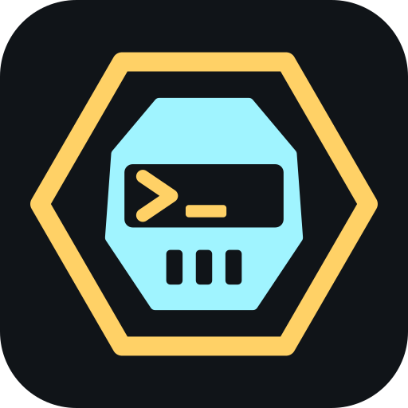
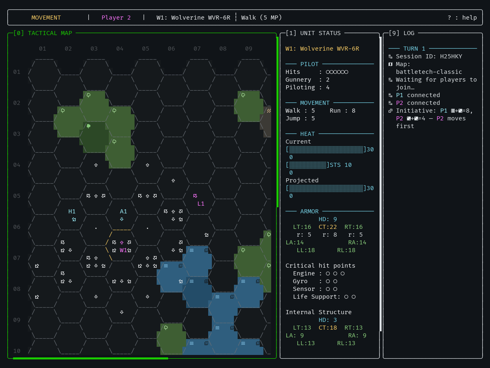

# Steelrain

A turn-based game of armored mech combat on a hex map, played in a terminal (TUI), following
the BattleTech tabletop rules. Supports hot-seat and network play.



Written in Kotlin. The TUI consumes [Tenter](https://github.com/archinautio/tenter) (`io.archinaut:tenter`) as a library resolved from Maven Central.

- [User documentation](https://archinautio.github.io/steelrain/) — installation, setup, controls,
  network play, custom content, and the game rules.
- [Documentation source](docs/site/index.md) — read the player guides in this checkout.
- [Architecture](docs/architecture.md) — module boundaries and implementation invariants.
- [Documentation maintenance](docs/documentation.md) — preview, validation, and publishing.

## Quick start

Download the game from the [releases](https://github.com/archinautio/steelrain/releases), either
with its own Java or as a jar for Java 25; see
[Getting started](docs/site/index.md#download). The game needs a terminal using a
[Nerd Font](https://www.nerdfonts.com/).

To build and run from source instead, with JDK 25:

```sh
./gradlew :tui:shadowJar
java -jar tui/build/libs/tui.jar hot-seat
```

With no command the game opens the interactive setup screen. See the
[command line reference](docs/site/command-line.md) for `hot-seat`, `host`, `join`, and `server`.

## License

Copyright (C) 2026 the project's contributors.

This program is free software: you can redistribute it and/or modify it under the terms of the
GNU General Public License version 3 as published by the Free Software Foundation. It is
distributed WITHOUT ANY WARRANTY; see [LICENSE](LICENSE) for the full text.

## Legal

BattleTech, BattleMech, 'Mech and MechWarrior are registered trademarks and/or trademarks of
The Topps Company, Inc. This is an unofficial, free, non-commercial fan project. It is not
affiliated with, endorsed, sponsored or approved by The Topps Company, Inc., Catalyst Game Labs,
InMediaRes Productions, LLC or Microsoft Corporation.
