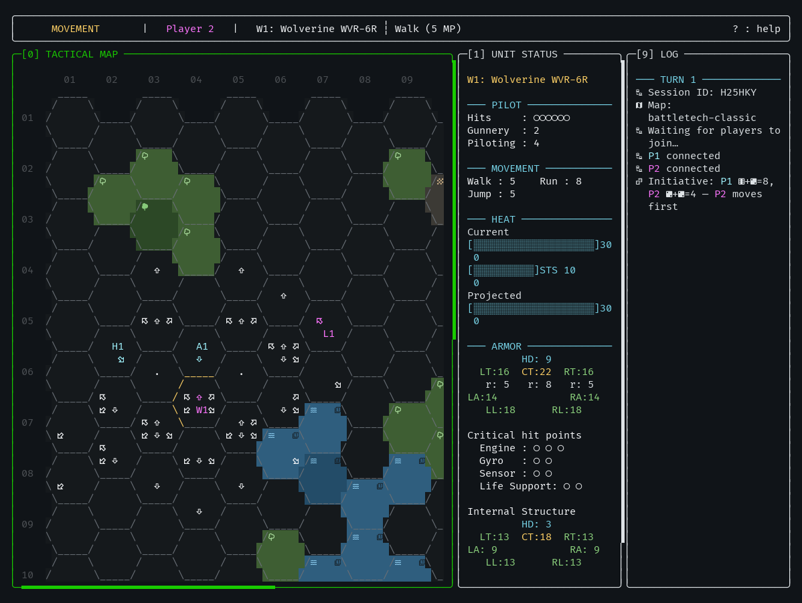

# Getting started

Steelrain is a turn-based game of armored combat on a hexagonal map, played in a terminal and
following the BattleTech tabletop rules. Two players each command a force of BattleMechs, either
sharing one terminal (hot-seat) or over the network.



!!! note "Early development"
    These pages follow the `main` branch, so they can describe features newer than the latest
    release.

## Requirements

- **A terminal using a [Nerd Font](https://www.nerdfonts.com/).** Units, terrain, dice and log
  markers are drawn with Nerd Font icons; other fonts show placeholder boxes instead.
- **A large enough window.** Around 200 × 50 characters shows the map and its side panels
  comfortably; the layout adapts to smaller sizes.
- Truecolor support is recommended. 256-color and 16-color terminals work too; see
  [Color themes](themes.md).

## Download

Each [release](https://github.com/archinautio/steelrain/releases) has two kinds of download.
Pick one:

- **With its own Java**, nothing else to install. Pick the file for your system:

    | System | File |
    |---|---|
    | macOS (Apple Silicon) | `steelrain-<version>-macos-aarch64.tar.gz` |
    | Linux (x86-64) | `steelrain-<version>-linux-x64.tar.gz` |
    | Linux (ARM64) | `steelrain-<version>-linux-aarch64.tar.gz` |
    | Windows (x86-64) | `steelrain-<version>-windows-x64.zip` |

    Unpack it anywhere. The game is the `steelrain` script inside (`steelrain.bat` on
    Windows); keep it next to `steelrain.jar` and the `runtime` folder. To run it from any
    directory, add that folder to your `PATH`, or on macOS and Linux link the script into a
    directory already on it.

- **The jar**, `steelrain-<version>.jar`, if you already have **Java 25** or later. Run it with
  `java -jar steelrain-<version>.jar`.

These pages write the game's command as `steelrain`. With the jar, type
`java -jar steelrain-<version>.jar` in its place; when you build from source, type
`java -jar tui/build/libs/tui.jar`. Run `steelrain --version` to see which version you have.

### Build from source

You need **JDK 25** and **Git**:

```sh
git clone https://github.com/archinautio/steelrain.git
cd steelrain
./gradlew :tui:shadowJar
```

The build produces a single runnable file, `tui/build/libs/tui.jar`. On Windows, use `gradlew.bat`
instead of `./gradlew`.

## Play your first match

```sh
steelrain hot-seat
```

The match starts right away, with both players sharing your keyboard. It uses the built-in
`default` scenario on the `classic` map: Player 1 has an Atlas and a Hunchback, and
Player 2 has two Wolverines.

The banner at the top always says whose turn it is and what to do next. A turn goes like this:

1. **Movement**: press `Tab` to select one of your mechs, move the cursor with `q` `w` `e` `a`
   `s` `d` to one of the highlighted hexes, press `Enter`, then choose the direction to face with
   the same keys.
2. **Weapon attack**: press `Tab` to select one of your mechs, `Space` to fire the weapon under
   the cursor (`↑`/`↓` to move between weapons), and `c` to commit.
3. **Physical attack**: mechs next to an enemy can punch or kick, in the same way.

Then heat is applied and the next turn begins, until only one side has mechs left. Press `?` at
any time to show the keys for the current screen, and `Ctrl+C` to quit. See
[Playing a match](playing.md) for the details.

## Set up your own match

To choose the map and the mechs yourself, start the game with no arguments:

```sh
steelrain
```

This opens the setup screen. To start a hot-seat match:

1. Press `c` to lock in **hot-seat** mode.
2. Press `Space` to select the map under the cursor.
3. Press `3` to focus **PLAYER 1**, then `Space` to add the mech under the cursor. Use
   `←` and `→` to change how many of that mech the player gets.
4. Press `4` and do the same for **PLAYER 2**.
5. Press `c` to start the match.

Mechs are placed automatically near each player's edge of the map. See
[Setting up a match](setup.md) for the details, and [Command line](command-line.md) to start
other maps and scenarios directly.
