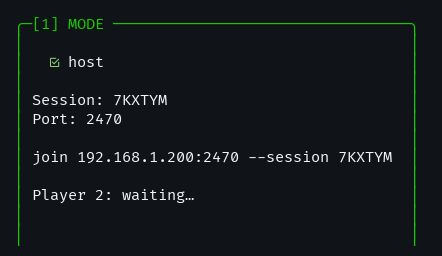

# Network play

Two players on different computers can play one match over TCP. One computer hosts the match; the
other joins it. The default port is **2470**.

The joining player needs only the game itself: the map and both forces come from the host,
including any custom maps and mechs the host registered.

## Host from the setup screen

1. Start the game with no command and choose **host** mode (see
   [Setting up a match](setup.md#choose-a-mode)).
2. The MODE panel shows the session ID, the port, and the `join` command for each of your network
   addresses. Send one of them to the other player.

    

3. When Player 2 connects, choose the map and both forces, then press `c` to start.

While you set up the match, the joining player sees your choices on a read-only setup screen.

## Host from the command line

```sh
battletech host --map river-valley
```

This starts the match with the selected map and unit collection as soon as the other player
joins. The session ID is shown in the LOG panel. `--port` changes the port; see
[Command line](command-line.md).

## Join

```sh
battletech join 192.168.1.20 --session UANS3U
```

Give the host's IP address or name, followed by `:port` if the host is not using port 2470, and the
session ID the host gave you.

If you are disconnected, run the same `join` command again to rejoin the match; the host waits for
you.

## Dedicated server

A dedicated server runs a match with no game screen, and both players join it:

```sh
battletech server --port 2470 --map lake-area
```

It prints the session ID and port when it starts:

```text
Session ID: UANS3U — listening on port 2470
```

## Firewalls

The host or server must accept incoming TCP connections on the chosen port. Across the internet,
forward that port on the host's router, or connect through a VPN.
