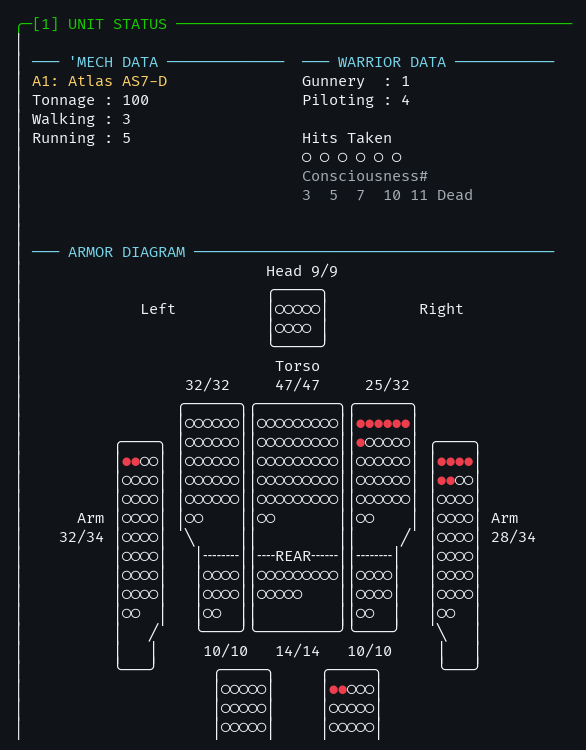
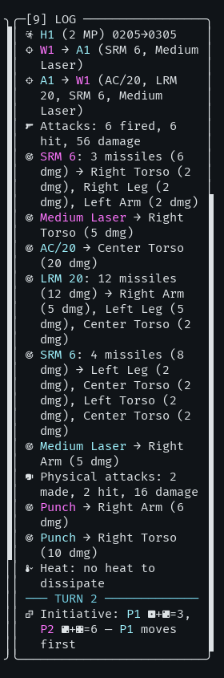
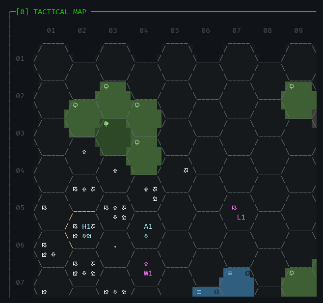
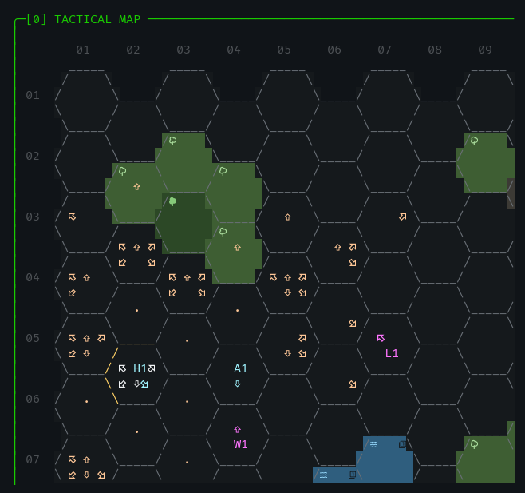
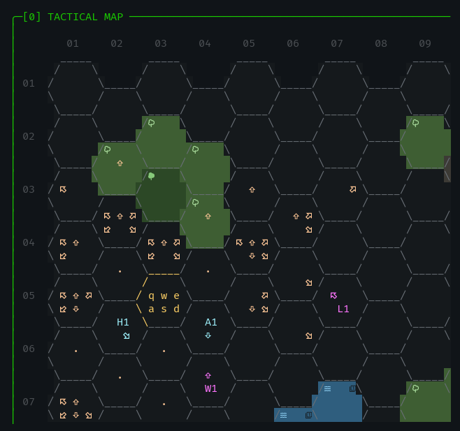
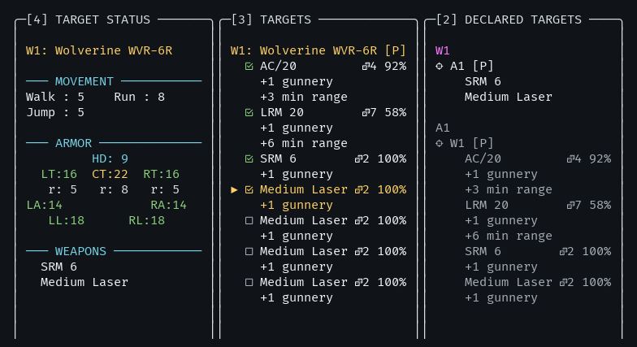
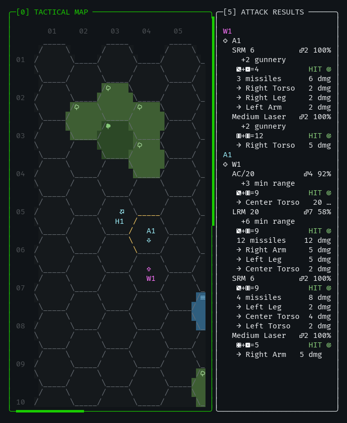
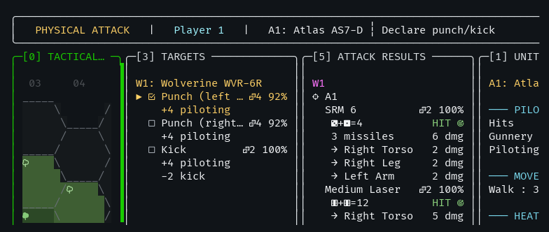
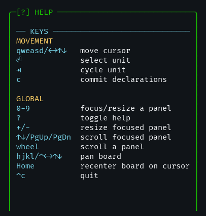

# Playing a match

## The game screen

The banner at the top shows the current phase, the player whose turn it is, and what to do next.
Below it, the screen is divided into panels. Each panel's number is the key that focuses it:

| Key | Panel | Shows |
|---|---|---|
| `0` | **TACTICAL MAP** | The hex map, the units, and the cursor. |
| `1` | **UNIT STATUS** | Armor, internal structure, heat, weapons and pilot of the unit under the cursor. Maximize it for the full record sheet. |
| `2` | **DECLARED TARGETS** | The weapon attacks declared so far this impulse. |
| `3` | **TARGETS** | During an attack, the targets the selected unit can attack and the weapons it can use against each. |
| `4` | **TARGET STATUS** | The status of the target under the cursor in the TARGETS panel. |
| `5` | **ATTACK RESULTS** | The outcome of the last attacks. |
| `9` | **LOG** | Everything that happened in the match: initiative and dice rolls, moves, hits, damage and heat. |
| `?` | **HELP** | The keys available right now. |

Some panels appear only in the phase that uses them.

Maximize **UNIT STATUS** (`1`, then `+`) for the full record sheet of the unit under the cursor,
with its armor diagram. Filled pips are armor already lost:



### Panels and the map

- Press a panel's number to focus it. Press `+` or `-` to enlarge or shrink the focused panel; a
  maximized panel fills the screen.
- `↑`/`↓` and `PgUp`/`PgDn` scroll the focused panel. The mouse wheel scrolls the panel under the
  pointer.
- `h` `j` `k` `l` or `Ctrl`+arrows pan the map; `Home` recenters it on the cursor.
- You can also click a hex on the map to move the cursor there or select the unit on it.

### The map

Each hex shows its terrain (clear, light woods, heavy woods, water, rough) and its elevation.
Map rows and columns are numbered along the edges. A unit is drawn with an arrow showing its
facing; the two players' units have different colors.

## A turn

Each turn runs through these phases in order. Phases that need no decisions happen
automatically, and their results appear in the LOG.

1. **Initiative**: each player rolls 2d6. The loser moves first; moving last is an advantage.
2. **Movement**: players alternate moving their units.
3. **Weapon attack**: players declare weapon fire; all attacks are resolved together.
4. **Physical attack**: units adjacent to an enemy may punch and kick.
5. **Heat**: each unit's heat from movement and weapons is added and its heat sinks dissipate
   heat. High heat brings penalties and can shut a unit down.
6. **End**: the game checks whether the match is over.

The match ends when only one side still has surviving units. See [Victory](rules/victory.md).

The LOG keeps the whole story of the match, turn by turn:



In a hot-seat match the banner names the player who must act; pass the keyboard to them. In a
network match, when it is not your turn the game shows **Waiting for opponent**.

## Movement

Players take turns activating units, one or more per turn as the banner says (see
[Movement](rules/movement.md#1-movement-sequence-alternating-activation)).

1. **Select a unit**: move the cursor onto one of your units and press `Enter` (or click it), or
   press `Tab` to cycle through the units that can still move.
2. **Choose the destination**: the hexes the unit can reach are highlighted. Press `x` to cycle
   between walking, running and jumping. Move the cursor to the destination.
3. **Choose the facing**: press `Enter` to confirm the path, then pick the final facing with
   `q` `w` `e` `a` `s` `d`. As a shortcut, press `Q` `W` `E` `A` `S` `D` (with `Shift`) while
   choosing the destination to move and face in one step.

Each reachable hex shows arrows for the facings the unit can end in there. Walking hexes are
white, running hexes orange:





After confirming the path, the destination hex shows the keys of the facings you can choose:



To stay in place, choose the unit's own hex as the destination. `Esc` goes back one step. A
prone unit tries to stand up first.

The facing keys follow the layout of the six hex sides:

```text
  q   w   e        NW   N   NE
  a   s   d        SW   S   SE
```

### Movement keys

| Key | Action |
|---|---|
| `q` `w` `e` `a` `s` `d` or arrows | Move the cursor |
| `Enter` | Select the unit under the cursor; confirm the path |
| `Tab` | Cycle to the next unit |
| `x` | Cycle the movement mode (walk, run, jump) |
| `Q` `W` `E` `A` `S` `D` | Move to the cursor and face that way |
| `q` `w` `e` `a` `s` `d` | Choose the facing (after confirming the path) |
| `Esc` | Back |

## Weapon attacks

As in movement, players take turns declaring attacks for their units, starting with the player who
lost initiative.

1. **Select an attacker** with `Enter` or `Tab`, as in movement.
2. The **TARGETS** panel lists every enemy the unit can attack, each with its weapons and their
   chance to hit. Move through the list with `↑`/`↓` (or `w`/`s`) and press `Space` to fire or
   hold a weapon at the target under the cursor. You can also click a target on the map.
3. Twist the torso with `←`/`→` (or `a`/`d`) to bring other targets into the firing arc.
4. Press `Tab` to move on to your next attacker, or `Esc` to go back.
5. Press `c` to commit your declarations. Units with nothing declared do not fire.

Each weapon shows its target number and chance to hit, with the modifiers that make it up. The
first target you fire at is the primary target, marked `[P]`:



Attacks are resolved together once every unit has had its turn to declare, so a unit destroyed
this phase still fires. Results appear in **ATTACK RESULTS** and
the LOG: the dice rolled, hit or miss, and where the damage landed.

 See [To-hit modifiers](rules/to-hit-modifiers.md), [Line of sight](rules/line-of-sight.md)
and [Armor and damage](rules/armor-damage.md).

## Physical attacks

Physical attacks work like weapon attacks, but the TARGETS panel lists the punches and kicks the
unit can make against adjacent enemies. Press `Space` to choose a punch or kick, `Tab` for the
next attacker, and `c` to commit. There is no torso twist. See
[Physical attacks](rules/physical-attacks.md).



### Attack keys

| Key | Action |
|---|---|
| `q` `w` `e` `a` `s` `d` or arrows | Move the cursor (selecting an attacker) |
| `Enter` | Select the attacker under the cursor |
| `↑`/`↓` or `w`/`s` | Move through targets and weapons |
| `Space` | Toggle the weapon, punch or kick under the cursor |
| `←`/`→` or `a`/`d` | Twist the torso (weapon attacks only) |
| `Tab` | Next attacker |
| `Esc` | Back |
| `c` | Commit the declarations |

## Keys on every screen

Press `?` to open the HELP panel with the keys for what you are doing now, followed by these:



| Key | Action |
|---|---|
| `0`–`9` | Focus a panel |
| `+`/`-` | Enlarge or shrink the focused panel |
| `↑`/`↓`, `PgUp`/`PgDn` | Scroll the focused panel |
| Mouse wheel | Scroll the panel under the pointer |
| `h` `j` `k` `l` or `Ctrl`+arrows | Pan the map |
| `Home` | Recenter the map on the cursor |
| `?` | Show or hide the key help |
| `Ctrl+C` | Quit |
