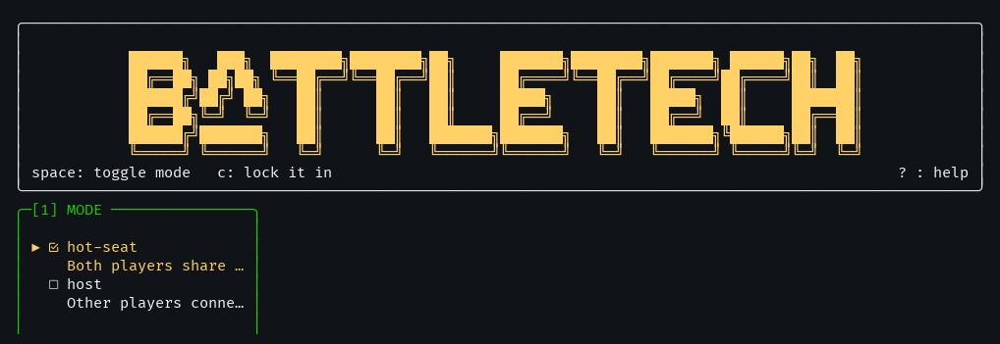
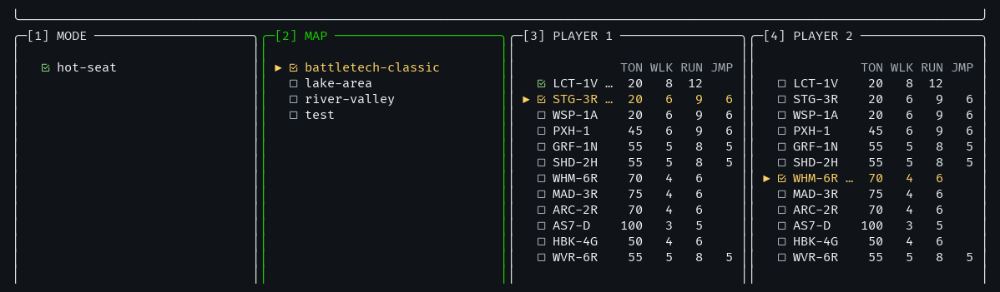
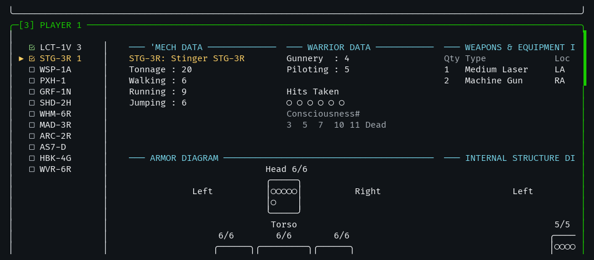
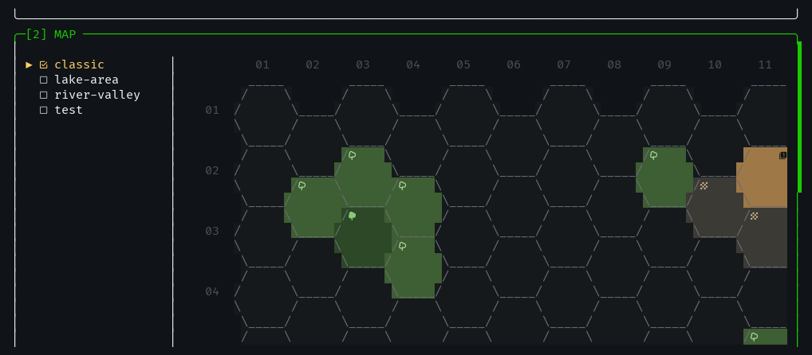

# Setting up a match

Running the game with no command opens the setup screen:

```sh
steelrain
```

The setup screen defines a match in two stages: first the mode, then the map and each player's
force.

## Choose a mode

Only the **[1] MODE** panel is shown at first:



| Mode | Use it when |
|---|---|
| **hot-seat** | Both players share this terminal and take turns at the keyboard. |
| **host** | You play Player 1 here and the other player joins from another computer. |

Press `Space` to switch between them, then `c` to lock the mode in.

In **host** mode, the MODE panel then shows the session ID, the port, and the exact `join`
command(s) the other player can run. The map and force panels appear once Player 2 connects. See
[Network play](network.md#host-from-the-setup-screen).

## Choose the map and forces

After the mode is locked, three more panels appear:

| Panel | What to do |
|---|---|
| **[2] MAP** | Move the cursor to a map and press `Space` to select it. |
| **[3] PLAYER 1** | Choose Player 1's mechs and how many of each. |
| **[4] PLAYER 2** | Choose Player 2's mechs and how many of each. |



The player panels list every available mech with its tonnage (**TON**) and its walking, running
and jumping movement points (**WLK**, **RUN**, **JMP**). In a player panel:

- `Space` adds the mech under the cursor (count 1), or removes it.
- `←`/`→` (or `a`/`d`) lowers or raises the count of the mech under the cursor.

Press `+` to maximize the focused panel. A maximized player panel shows the count next to each
selected mech, and the record sheet of the mech under the cursor: its data, pilot, weapons and
armor.



A maximized MAP panel previews the map under the cursor:



Press `c` to start the match. If something is missing, the banner says what (for example
`select a map` or `player 2 has no units`). Each player needs at least one mech, and a map has
room for only so many units near each player's edge, so a very large force may not fit on a small
map.

Every mech is placed at a random hex in the two rows nearest its player's edge of the map, Player
1 facing north and Player 2 facing south. Every pilot has Gunnery 4 and Piloting 5.

!!! tip "Fixed starting positions"
    To control exactly where each mech starts, and its pilot's skills, write a unit collection
    and start the match from the command line instead. See
    [Custom maps, units and mechs](custom-content.md#unit-collections).

## Setup keys

| Key | Action |
|---|---|
| `1`–`4` | Focus a panel |
| `↑`/`↓` or `w`/`s` | Move the cursor |
| `←`/`→` or `a`/`d` | Adjust the count of the mech under the cursor |
| `Space` | Toggle the selection under the cursor |
| `Enter` or `Tab` | Focus the next panel |
| `+`/`-` | Enlarge or shrink the focused panel; a maximized MAP panel previews the map |
| `h` `j` `k` `l` or `Ctrl`+arrows | Pan a maximized map preview |
| `c` | Lock in the mode, then start the match |
| `?` | Show or hide the key help |
| `Ctrl+C` | Quit |

Content you register on the command line with `--add-map` and `--add-mech` also appears in these
lists. See [Command line](command-line.md).
