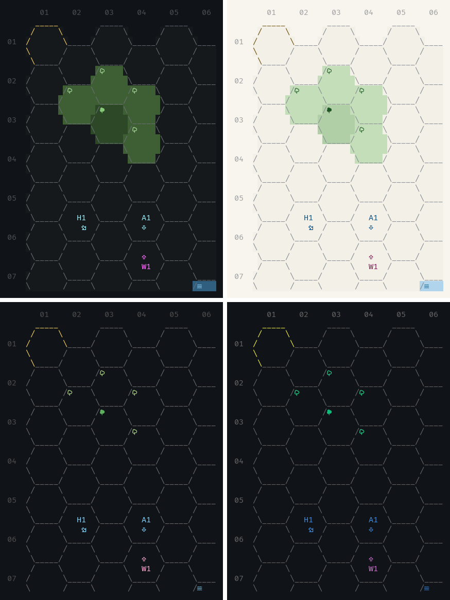

# Color themes

The game has six built-in color themes, a dark and a light one for each level of terminal color
support:

| Terminal colors | Dark | Light |
|---|---|---|
| Truecolor (16 million colors) | `dark` | `light` |
| 256 colors | `dark-256` | `light-256` |
| 16 colors | `dark-16` | `light-16` |

Without `--theme`, the game picks the dark theme that matches your terminal's color support. It
cannot detect a light terminal background, so choose a light theme yourself:

```sh
battletech --theme light
```

`--theme` must come before the command name, for example `--theme light-256 hot-seat`.

The truecolor themes fill each hex with a terrain color. The 256- and 16-color themes keep hexes
on the plain background and show the terrain through the icon's color and shape. The 16-color
themes use your terminal's own palette, so their exact look depends on your terminal settings.



## Custom themes

`--theme` also accepts the path of a theme file:

```sh
battletech --theme ./my-theme.json
```

If the path exists, the game uses that file and reports any error in it; otherwise the value is
taken as a built-in theme name. `--list-themes` lists the built-in themes, plus the file given
with `--theme`.

The easiest start is a copy of a built-in theme from the
[`theme/` directory](https://github.com/archinautio/battletech/tree/main/theme) of the repository.

### File format

```json
{
  "colorSpace": "truecolor",
  "background": "#101418",
  "standard": { "DEFAULT": "#DDE2E5", "...": "..." },
  "app": { "DRAFT": "#A6ADB4" },
  "heatScale": { "CURRENT_BG": "#3A3218", "...": "..." },
  "board": { "PLAYER_1": "#A0F4FF", "...": "..." }
}
```

`colorSpace` sets how every color in the file is written:

| `colorSpace` | Color values |
|---|---|
| `truecolor` | `#RRGGBB` |
| `ansi256` | A palette index as a string, `"16"` to `"255"` |
| `ansi16` | An SGR color code as a string, `"30"`–`"37"` or `"90"`–`"97"` |

Each table must name exactly these roles. A missing or unknown role stops the game with an error
that names it.

| Table | Roles |
|---|---|
| `standard` | `DEFAULT`, `TEXT_PRIMARY`, `TEXT_MUTED`, `TEXT_SUBTLE`, `ACCENT`, `INFO`, `SUCCESS`, `WARNING`, `DANGER`, `DISABLED`, `PANEL_BORDER`, `PANEL_BORDER_FOCUSED` |
| `app` | `DRAFT`: text for attacks that are declared but not yet committed |
| `heatScale` | `CURRENT_BG`, `HEATING_BG`, `COOLING_BG`: backgrounds of the heat scale's current level, and of the levels the unit will heat up or cool down through |
| `board` | Units: `PLAYER_1`, `PLAYER_2`, `DESTROYED`<br>Map: `BOARD_BORDER`, `BOARD_ACTIVE`<br>Movement: `MOVE_WALK`, `MOVE_RUN`, `MOVE_JUMP`<br>Attacks: `ATTACK_RANGE`, `LINE_OF_SIGHT`, `TARGET_VALID`, `TARGET_SELECTED`<br>Terrain fills: `TERRAIN_CLEAR_BG`, `TERRAIN_WOODS_LIGHT_BG`, `TERRAIN_WOODS_HEAVY_BG`, `TERRAIN_WATER_SHALLOW_BG`, `TERRAIN_WATER_DEEP_BG`, `TERRAIN_WATER_VERY_DEEP_BG`, `TERRAIN_ROUGH_BG`<br>Terrain icons: `TERRAIN_WOODS_LIGHT_ICON`, `TERRAIN_WOODS_HEAVY_ICON`, `TERRAIN_WATER_ICON`, `TERRAIN_ROUGH_ICON`<br>Elevation: `ELEVATION_1_BADGE_BG`, `ELEVATION_2_BADGE_BG`, `ELEVATION_HIGH_BADGE_BG`, `ELEVATION_BADGE_FG` |

Keep `PLAYER_1` and `PLAYER_2` clearly different from each other and readable on every terrain
fill: unit ownership is shown only by color.
